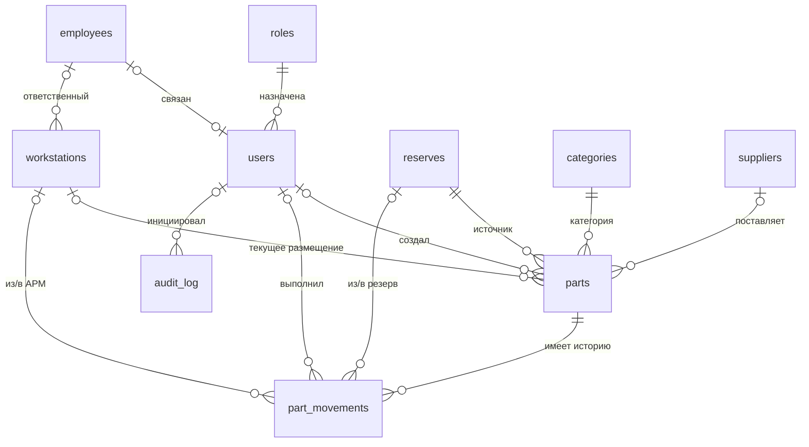

# Учёт комплектующих АРМ МИАЦ

Рабочий прототип локального веб-приложения для учёта комплектующих, закреплённых за АРМ МИАЦ и Минздрава. Интерфейс, сообщения и печатные отчёты русифицированы. Приложение не использует облачные сервисы и после сборки работает без доступа к Интернету.

> Это прототип с защитными механизмами, а не аттестованная информационная система. Итоговый класс защищённости, состав мер и средства защиты определяются моделью угроз, категорированием/классификацией объекта и проектом системы защиты.

## Шаг 1. Архитектура

Приложение реализовано как серверный монолит на FastAPI. Один процесс обслуживает маршруты, Jinja2-шаблоны и локальные статические файлы Bootstrap 5.3.8/Bootstrap Icons 1.13.1. Такой вариант не требует Node.js и SPA-инфраструктуры, прозрачен для сопровождения в закрытом контуре и позволяет проверять права непосредственно перед каждой операцией.

PostgreSQL является единственным источником истины. Таблица `parts` хранит текущее состояние, а `part_movements` — неизменяемую деловую историю. Изменение состояния, запись движения и событие `audit_log` выполняются одной транзакцией. Конкурирующие операции блокируют строку комплектующего через `SELECT ... FOR UPDATE`, поэтому одно комплектующее нельзя одновременно установить в два АРМ.

Сессия хранится в подписанной cookie и содержит только идентификатор пользователя и CSRF-токен. Пароли хешируются bcrypt. Для изменяющих операций используются CSRF-защита и роли `admin`, `storekeeper`, `viewer`. После пяти неудачных попыток вход блокируется на 15 минут. Сотрудник и пользователь меняют первичный пароль при первом входе; для администратора принудительная смена отключена.

### Структура каталогов

```text
.
├── app/
│   ├── main.py                 # создание FastAPI, middleware, главная и аудит
│   ├── config.py               # настройки только из окружения/.env
│   ├── db.py                   # SQLAlchemy engine и сессии
│   ├── models.py               # ORM-модели и русские подписи состояний
│   ├── auth.py                 # вход, bcrypt, CSRF и require_role
│   ├── audit.py                # запись обязательного аудита
│   ├── templating.py           # единый контекст Jinja2 и уведомления
│   ├── routes/
│   │   ├── parts.py            # карточки, приход, перенос и списание
│   │   ├── workstations.py     # АРМ, установка, возврат и перемещение
│   │   ├── reports.py          # четыре отчёта и выгрузки PDF/XLSX
│   │   ├── catalogs.py         # резервы, категории, сотрудники, поставщики
│   │   └── users.py            # учётные записи сотрудников (только admin)
│   ├── templates/              # русскоязычные Jinja2-шаблоны
│   └── static/                 # стили, JS и локальные Bootstrap-ресурсы
├── schema.sql                  # полная схема PostgreSQL 15+
├── migrations/                 # идемпотентные обновления существующей БД
├── Dockerfile
├── docker-compose.yml
├── requirements.txt
├── .env.example
└── README.md
```

### ER-описание



Основные правила целостности:

- `parts.reserve_id` и `parts.category_id` обязательны;
- статус может иметь только значения `in_stock`, `installed`, `written_off`;
- АРМ заполнено только у комплектующего со статусом `installed`;
- непустые серийный и инвентарный номера комплектующего уникальны;
- комплектующее можно явно поставить на учёт без инвентарного номера;
- АРМ идентифицируется внутренним ID и наименованием, без обязательного инвентарного номера;
- использованные элементы справочников архивируются, а не удаляются; физическое удаление разрешено только при отсутствии связей;
- история движений не удаляется через пользовательский интерфейс.

## Шаг 2. Схема PostgreSQL

Полная схема находится в [schema.sql](schema.sql). Скрипт создаёт все обязательные таблицы, внешние ключи, проверки, индексы поиска, русские `COMMENT ON`, роли и стартовые значения резервов/категорий. При первом создании Docker-тома PostgreSQL выполняет его автоматически.

Обязательные таблицы: `reserves`, `categories`, `parts`, `workstations`, `employees`, `suppliers`, `part_movements`, `users`, `roles`, `audit_log`.

## Шаг 3. Docker и зависимости

Используются [docker-compose.yml](docker-compose.yml), [Dockerfile](Dockerfile) и [requirements.txt](requirements.txt). PostgreSQL доступен только внутренней backend-сети. Приложение дополнительно подключено к frontend-сети, через которую порт публикуется только на loopback-интерфейсе узла. Контейнер приложения работает от непривилегированного пользователя, с read-only root filesystem и `no-new-privileges`.

## Шаг 4. Backend

Ключевые модули:

- [app/main.py](app/main.py) — инициализация FastAPI, middleware, статика, начальные пользователи, главная панель и просмотр аудита;
- [app/models.py](app/models.py) — SQLAlchemy-модели, соответствующие `schema.sql`;
- [app/auth.py](app/auth.py) — вход, блокировка, bcrypt, смена пароля, CSRF и `require_role`;
- [app/routes/parts.py](app/routes/parts.py) — CRUD карточек, фильтры, приход, перенос резерва и списание;
- [app/routes/workstations.py](app/routes/workstations.py) — карточки АРМ, установка, возврат и перемещение между АРМ;
- [app/routes/reports.py](app/routes/reports.py) — остатки по резервам, состав конкретного АРМ, списки сотрудников и всех АРМ; каждый отчёт выгружается в PDF и XLSX.
- [app/routes/users.py](app/routes/users.py) — создание и блокировка связанных с сотрудниками учётных записей.

Физическое удаление комплектующих и учётных записей запрещено. Администратор может мягко удалить любую карточку с обязательным указанием причины, после чего она исключается из рабочих списков, АРМ и отчётов. В разделе «Удалённые» карточка восстанавливается вместе со всеми связями и историей движения.

Управление учётными записями доступно только администратору. Одна запись связывается с одним действующим сотрудником. Для ролей «Сотрудник» и «Пользователь» первичный пароль требуется сменить при первом входе; безопасный генератор доступен как при выдаче первичного пароля, так и на экране обязательной смены, заполняет подтверждение и копирует пароль в буфер обмена. Для роли «Администратор» генератор скрыт, разрешён простой выдаваемый пароль от пяти символов, а принудительная смена отключена. В списке учётных записей администратор может сбросить забытый пароль: обычная роль после этого должна сменить его при следующем входе. Администратор может изменить ФИО и роль, но уникальный логин остаётся неизменным; ФИО синхронизируется со справочником сотрудников. Помимо временной блокировки доступны мягкое удаление и восстановление пользователя; удалённая запись немедленно теряет доступ. Нельзя удалить текущую запись или лишить последнего действующего администратора его роли. События журнала можно удалить из основного списка только администратору и только с указанием причины. Это мягкое удаление: исходная запись остаётся в БД, а операция удаления создаёт отдельное неснимаемое событие аудита.

## Шаг 5. Frontend

Базовый шаблон [app/templates/base.html](app/templates/base.html) содержит фиксированную боковую навигацию, мобильное меню и хлебные крошки. Требуемые экраны находятся в:

- [app/templates/parts/list.html](app/templates/parts/list.html) — список с поиском и фильтрами;
- [app/templates/parts/detail.html](app/templates/parts/detail.html) — карточка и история комплектующего;
- [app/templates/workstations/detail.html](app/templates/workstations/detail.html) — карточка АРМ и операции;
- [app/templates/reports](app/templates/reports) — печатные отчёты и кнопки выгрузки PDF/Excel.

Bootstrap и Bootstrap Icons сохранены в `app/static/vendor`, поэтому браузер не обращается к внешнему CDN.

Справочники разделены на отдельные вкладки: резервы, категории, сотрудники и поставщики. Администратор может изменять реквизиты, архивировать, восстанавливать и удалять неиспользуемые элементы. Код резерва после создания изменить нельзя. Все управляющие действия оформлены единым набором локальных Bootstrap Icons и снабжены русскими подсказками. В каждой таблице автоматически доступен быстрый текстовый фильтр по отображённым строкам; журнал дополнительно фильтруется на сервере по пользователю, действию и периоду. Пустые поля серверных фильтров корректно трактуются как отсутствие условия.

В списке комплектующих доступны явные кнопки изменения и мягкого удаления. Для АРМ также доступны изменение, мягкое удаление с обязательной причиной и восстановление; АРМ с установленными комплектующими удалить нельзя. Карточка АРМ отдельно показывает основные группы: «Материнская плата + процессор», «Оперативная память» и «Блок питания», после чего выводит полный установленный состав. Зелёная отметка состояния появляется только при наличии материнской платы, процессора, оперативной памяти и блока питания; неполная комплектация отмечается красным крестиком.

## Шаг 6. Развёртывание

### Требования

- Docker Engine 24+;
- Docker Compose v2;
- свободный локальный порт `8080`;
- минимум 2 ГБ ОЗУ и 2 ГБ диска для стенда.

### Первый запуск

1. Создать локальный файл окружения:

   ```bash
   cp .env.example .env
   ```

2. В `.env` обязательно заменить `POSTGRES_PASSWORD` и тот же пароль внутри `DATABASE_URL`, а также сгенерировать новый `SESSION_SECRET` длиной не менее 32 символов. Первичные пароли тоже следует заменить до промышленного запуска.

3. Собрать и запустить контейнеры:

   ```bash
   docker compose up -d --build
   ```

4. Проверить состояние:

   ```bash
   docker compose ps
   curl http://127.0.0.1:8080/health
   ```

5. Открыть `http://127.0.0.1:8080`.

По умолчанию порт публикуется только на `127.0.0.1:8080`. Для доступа из защищённой ЛВС рекомендуется оставить такое связывание и разместить перед приложением локальный сертифицированный/допустимый reverse proxy с TLS. Прямую публикацию `8080:8080` можно делать только после настройки межсетевого экранирования и перечня разрешённых узлов в `ALLOWED_HOSTS`.

### Первичные учётные записи

| Роль | Логин | Первичный пароль |
|---|---|---|
| Администратор | `admin` | `admin` |
| Сотрудник | `storekeeper` | `storekeeper` |
| Пользователь | `viewer` | `viewer` |

**Первичные пароли сотрудника и пользователя необходимо сменить при первом входе.** Администратор не перенаправляется на обязательную смену, но его пароль из `.env` необходимо заменить до эксплуатации.

### Остановка и журналы

```bash
docker compose logs -f app
docker compose stop
```

Команда `docker compose down -v` удаляет базу данных и для рабочего контура не должна применяться без подтверждённой резервной копии.

### Обновление существующей БД

`schema.sql` автоматически исполняется только при создании пустого тома PostgreSQL. Идемпотентные SQL-обновления прототипа находятся в `migrations/`; для промышленной версии следует внедрить управляемые миграции Alembic и выполнять их по утверждённому регламенту с предварительной резервной копией.

## Шаг 7. Чек-лист ФСТЭК и подготовки к аттестации

| № | Мера | Состояние прототипа / дальнейшие действия |
|---:|---|---|
| 1 | Идентификация и аутентификация | Реализованы локальные учётные записи, bcrypt, временная блокировка, обязательная смена первичного пароля для сотрудника и пользователя. Для эксплуатации нужны утверждённые параметры политики, срок действия, история паролей и регламент разблокировки. |
| 2 | Разграничение доступа | Реализованы роли `admin`, `storekeeper`, `viewer` и серверные проверки. До аттестации нужна матрица доступа, утверждённая владельцем информации, и периодический пересмотр прав. |
| 3 | Регистрация событий безопасности | Реализован `audit_log` с пользователем, действием, сущностью, временем и IP; бизнес-событие пишется в общей транзакции. Администратор приложения может только мягко скрыть событие с причиной и отдельной контрольной записью. Нужны защита от изменения администратором БД, синхронизация времени, экспорт в защищённое хранилище/SIEM и регламент анализа. |
| 4 | Защита сетевого взаимодействия | Добавлены secure-заголовки, CSP, CSRF, закрытая Docker-сеть и привязка к loopback. Требуется HTTPS с утверждёнными алгоритмами/сертификатами, reverse proxy, межсетевой экран и запрет неиспользуемых направлений. После TLS установить `SESSION_HTTPS_ONLY=true`. |
| 5 | Защита конфигурации и секретов | Секреты читаются из `.env`, файл исключён из Git; контейнер непривилегированный и read-only. В промышленной среде нужны права ОС на `.env`, регламент ротации, отдельные сервисные учётные записи и исключение секретов из резервных копий/журналов. |
| 6 | Целостность и учёт операций | Есть FK, CHECK, уникальные индексы, блокировки строк и неизменяемая прикладная история. Нужны контроль целостности ПО, подписанный дистрибутив, доверенная загрузка и регламент управления изменениями. |
| 7 | Резервное копирование и восстановление | Docker-том сохраняет БД между перезапусками. До ввода необходимы зашифрованные резервные копии PostgreSQL, отдельная площадка хранения, RPO/RTO и регулярные тесты восстановления. |
| 8 | Управление уязвимостями | Зависимости зафиксированы по версиям, внешние ресурсы интерфейса локализованы. Нужны внутренний зеркальный репозиторий, проверка SBOM/уязвимостей, контроль образов, антивирусная проверка и регламент обновлений. |
| 9 | Защита инфраструктуры | БД не публикует порт наружу, включены `no-new-privileges` и минимальный образ. Нужны аттестованная ОС/СУБД по выбранному уровню, СЗИ НСД, контроль съёмных носителей, сегментация и физическая защита. |
| 10 | Организационные документы и испытания | Кодом не закрывается. Нужны модель угроз, техническое задание на систему защиты, описание ролей и процессов, комплект эксплуатационной документации, анализ исходного кода, нагрузочные/пентесты и аттестационные испытания. |

Нормативный набор требований нельзя определить только по описанию приложения: он зависит от вида системы, состава обрабатываемых данных (включая наличие персональных и медицинских данных), класса/уровня защищённости и актуальной модели угроз. Перед промышленным внедрением это должен подтвердить лицензированный исполнитель работ по защите информации.

## Проверка прототипа

В ходе разработки выполнены:

- компиляция всех Python-модулей;
- загрузка 17 Jinja2-шаблонов;
- конфигурация 10 SQLAlchemy-моделей и 46 HTTP-маршрутов;
- исполнение `schema.sql` на временном PostgreSQL;
- вход `admin` без принудительной смены пароля и открытие главной страницы;
- создание сотрудника, АРМ и комплектующего, затем установка в АРМ;
- проверка карточек, обоих отчётов, справочников и журнала аудита;
- проверка запрета записи для роли `viewer` (`HTTP 403`).

Docker Compose успешно проходит разбор конфигурации. Контейнерный запуск требует работающего Docker daemon.
